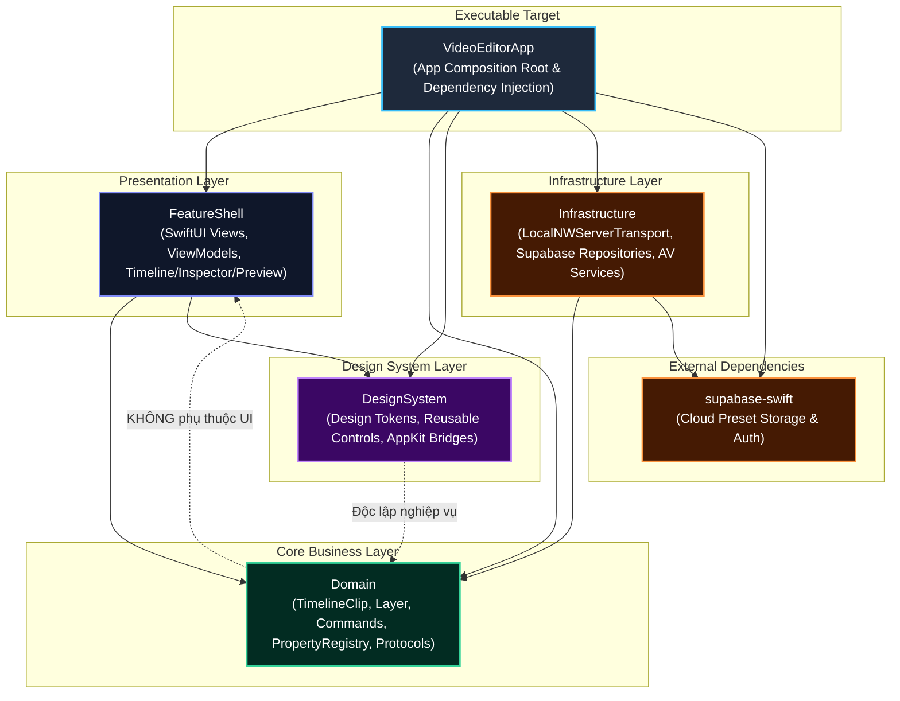
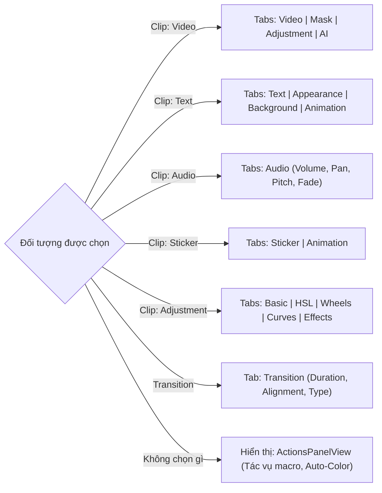
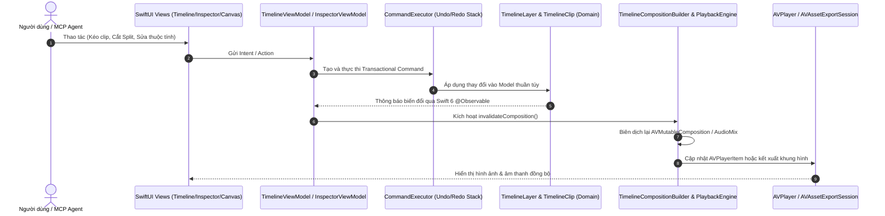

# VideoEditor — Bản đồ Kiến trúc & Hệ thống (System Blueprint)

> **Nền tảng:** macOS (14.0+) | **Ngôn ngữ:** Swift 6 (Complete Strict Concurrency) | **UI Framework:** SwiftUI & AppKit Bridges  
> **Media Engine:** AVFoundation + CoreGraphics | **Quản lý trạng thái:** Observation Framework (`@Observable`)  
> **Tiêu chuẩn quản trị:** Antigravity Agent Standard (AAS) — Xem chi tiết tại [AGENTS.md](file:///Users/nguyenquocduong/Documents/VideoEditor/AGENTS.md)

---

## Mục lục
1. [Tổng quan & Sứ mệnh tài liệu](#1-tổng-quan--sứ-mệnh-tài-liệu)
2. [Bản đồ Phân tầng Kiến trúc (Layered Architecture Map)](#2-bản-đồ-phân-tầng-kiến-trúc-layered-architecture-map)
3. [Bản đồ Bố cục Giao diện (UI Layout & Topology Wireframe)](#3-bản-đồ-bố-cục-giao-diện-ui-layout--topology-wireframe)
4. [Bản đồ Chi tiết Giao diện & Ánh xạ Mã nguồn](#4-bản-đồ-chi-tiết-giao-diện--ánh-xạ-mã-nguồn)
   - [4.1 Topbar (Thanh điều hướng đỉnh)](#41-topbar-thanh-điều-hướng-đỉnh)
   - [4.2 Khối Sidebar Trái & 7 Tab Chức năng](#42-khối-sidebar-trái--7-tab-chức-năng)
   - [4.3 Khối Canvas Preview Trung tâm (Màn hình xem trước)](#43-khối-canvas-preview-trung-tâm-màn-hình-xem-trước)
   - [4.4 Khối Inspector Phải (Bảng thuộc tính đối tượng)](#44-khối-inspector-phải-bảng-thuộc-tính-đối-tượng)
   - [4.5 Khối Timeline Đa lớp Bên dưới (Trục thời gian biên tập)](#45-khối-timeline-đa-lớp-bên-dưới-trục-thời-gian-biên-tập)
5. [Bản đồ Luồng Dữ liệu, Trạng thái & Lệnh (Dataflow, State & Command Stack)](#5-bản-đồ-luồng-dữ-liệu-trạng-thái--lệnh-dataflow-state--command-stack)
6. [Bản đồ Các Phân hệ Nâng cao (Advanced Subsystems Map)](#6-bản-đồ-các-phân-hệ-nâng-cao-advanced-subsystems-map)
   - [6.1 MCP Automation Server (Port 4088)](#61-mcp-automation-server-port-4088)
   - [6.2 Supabase Cloud Preset Synchronization](#62-supabase-cloud-preset-synchronization)
   - [6.3 AI Vision & Audio Signal Processing](#63-ai-vision--audio-signal-processing)
7. [Sổ tay Kiểm soát & Tái cấu trúc An toàn (Safe Refactoring & Extension Playbook)](#7-sổ-tay-kiểm-soát--tái-cấu-trúc-an-toàn-safe-refactoring--extension-playbook)
8. [Mục lục Tra cứu Nhanh Mã Nguồn (Directory & File Quick Reference)](#8-mục-lục-tra-cứu-nhanh-mã-nguồn-directory--file-quick-reference)

---

## 1. Tổng quan & Sứ mệnh tài liệu

Tài liệu này là **Master Blueprint (Bản đồ tổng thể hệ thống)** của ứng dụng `VideoEditor`. Mục đích cốt lõi là cung cấp góc nhìn x-quang toàn diện về:
- Cấu trúc phân tầng module và ranh giới trách nhiệm.
- Bản đồ topology trực quan của từng pixel giao diện người dùng.
- Vòng đời dữ liệu từ thao tác chuột, lệnh Command/Undo-Redo, đồng bộ AVFoundation Playback Engine, tới điều khiển tự động qua AI/MCP.
- Quy chuẩn và điểm tựa vững chắc để lập trình viên hoặc AI Agent tiến hành bảo trì, nâng cấp tính năng mới hoặc tái cấu trúc (refactoring) mà **không phá vỡ bất biến của hệ thống**.

---

## 2. Bản đồ Phân tầng Kiến trúc (Layered Architecture Map)

Hệ thống được thiết kế theo mô hình Clean Architecture phân tách thành 5 SPM Targets nghiêm ngặt, tuân thủ nguyên tắc một chiều (Dependency Inversion Rule).



### Nguyên tắc Bất biến Ranh giới Module:
1. **`Domain` (Lõi nghiệp vụ thuần khiết):** Không phụ thuộc SwiftUI, AppKit hay bất kỳ package bên ngoài nào. Chỉ chứa entities, math, time logic (`CMTime`), command protocols, và mô hình dữ liệu.
2. **`DesignSystem` (Thư viện dùng chung):** Chứa các Atomic Tokens (`DSColors`, `DSSize`, `DSSpacing`, `DSRadius`) và các Controls tái sử dụng (`DSSlider`, `DSRotationWheel`, `DSColorSpectrumPicker`, v.v.). Hoàn toàn không chứa logic nghiệp vụ video.
3. **`FeatureShell` (Tầng biểu diễn giao diện):** Kết nối `Domain` và `DesignSystem`. Sử dụng mô hình `Observation` (`@Observable`) và AppKit Host bridges để tối ưu hiệu năng render macOS.
4. **`Infrastructure` (Dịch vụ hạ tầng):** Triển khai các protocol do `Domain` định nghĩa: Supabase Cloud Client, Network Socket MCP Transport, Vision Subject Tracking, MelSpectrogram & Audio Beat Detection.
5. **`VideoEditorApp` (Composition Root):** Khởi tạo `EditorDependencies`, tiêm phụ thuộc (Dependency Injection), thiết lập window chính, menu commands và socket MCP server.

---

## 3. Bản đồ Bố cục Giao diện (UI Layout & Topology Wireframe)

Toàn bộ ứng dụng được bố cục trong một cửa sổ hợp nhất không viền chuẩn macOS (`WindowStyle.hiddenTitleBar`), tối ưu không gian làm việc chuyên nghiệp theo chuẩn tỉ lệ vàng.

```
+---------------------------------------------------------------------------------------------------------+
| [● ● ●] Dự án: Untitled.veproject  [↶ Undo] [↷ Redo] [Tỉ lệ 16:9 ▾]                 [Xuất Video MP4 ▾] | <- TopbarView
+-----------------------+-------------------------------------------------+-------------------------------+
| SIDEBAR (Trái)        | CANVAS PREVIEW (Trung tâm)                      | INSPECTOR (Phải)              |
| Width: 280-320pt      | Tự động co giãn theo tỉ lệ khung hình           | Width: 280-320pt              |
|                       |                                                 |                               |
| [Tab Icons Bar]       | +---------------------------------------------+ | [Dynamic Tab Bar]             |
| [Media]   [Audio]     | |                                             | | [Video] [Mask] [Adj] [AI]     |
| [Text]    [Sticker]   | |             AVPlayer & Metal /              | |-------------------------------|
| [Effect]  [Transition]| |          CoreGraphics Gizmo Layer           | | ▼ Vị trí & Kích thước         |
| [Adjustment]          | |                                             | |   X: [ 0.0 ]   Y: [ 0.0 ]     |
|                       | |         [Bounding Box / Transform]          | |   Scale: [100%] Rotation: 0°  |
| --------------------- | +---------------------------------------------+ | ▼ Hoà trộn & Độ trong suốt    |
| Danh sách nội dung    |                                                 |   Opacity: ===●======= 100%     |
| (Media Asset Grid,    | [⏮] [⏪] [ ▶ / ⏸ ] [⏩] [⏭]    00:01:23 / 00:05:00| ▼ Xử lý âm thanh              |
|  Presets, Typography, | Chế độ: [100% fit ▾]  [So sánh A/B]  [Lưới Grid]|   Volume: =====●====== 1.0      |
|  Filters, Transitions)|                                                 |   Pan: L ------|------ R        |
+-----------------------+-------------------------------------------------+-------------------------------+
| TIMELINE VIEW (Toàn chiều rộng bên dưới)                                                                |
| Toolbar: [Con trỏ] [Dao cạo Split] [Xoá] [Hút nam châm Snap: BẬT] [Ripple: BẬT]  Zoom: [ - ===●=== + ]  |
| Thước đo thời gian (Ruler):  |--- 00:00 ---|--- 00:01 ---|--- 00:02 ---|--- 00:03 ---|--- 00:04 ---|    |
| ------------------------------------------------------------------------------------------------------- |
| Track V2 [👁][🔒]  |   [   Text Title Clip   ]                 [  Sticker Badge  ]                     |
| Track V1 [👁][🔒]  |   [   Video Clip A.mp4  ] [Trans] [   Video Clip B.mov (Masked)    ]              |
| Track A1 [🔊][🔒]  |   [~~~~~~~~~~ Waveform Audio Sóng Âm Video A ~~~~~~~~~~]                           |
| Track A2 [🔊][🔒]  |                   [~~~~~~~~~~ BGM Sound Track ~~~~~~~~~~] (Beat Markers: ♦ ♦ ♦)   |
| ------------------------------------------------------------------------------------------------------- |
| Thanh cuộn ngang đồng bộ & Con trỏ Playhead đỏ dẫn đường thời gian thực                                |
+---------------------------------------------------------------------------------------------------------+
```

---

## 4. Bản đồ Chi tiết Giao diện & Ánh xạ Mã nguồn

### 4.1 Topbar (Thanh điều hướng đỉnh)
- **Tệp nguồn chính:** [`TopbarView.swift`](file:///Users/nguyenquocduong/Documents/VideoEditor/Sources/FeatureShell/View/TopbarView.swift)
- **Thành phần chức năng:**
  - `DSTrafficLights`: Nút điều khiển cửa sổ macOS tùy chỉnh (`Close`, `Minimize`, `Zoom`).
  - `DSRatioSelector`: Lựa chọn tỷ lệ khung hình (`16:9`, `9:16`, `1:1`, `4:3`, `21:9`) liên kết trực tiếp với `TimelineViewModel.canvasAspectRatio`.
  - Nhóm nút Hoàn tác/Làm lại: Trạng thái `canUndo` / `canRedo` điều khiển qua `TimelineViewModel.commandExecutor`.
  - Nhóm nút Quản lý Dự án: Mở dự án (`TimelineProjectIO.openProject`), Lưu (`TimelineProjectIO.saveProject`).
  - Nút Xuất bản: Kích hoạt `ExportDialogView` (Xuất Video MP4 / Audio Only).

---

### 4.2 Khối Sidebar Trái & 7 Tab Chức năng
Quản lý tập trung qua `TabRegistry` ([`TabRegistry.swift`](file:///Users/nguyenquocduong/Documents/VideoEditor/Sources/FeatureShell/Registry/TabRegistry.swift)). Mỗi tab là một `SidebarTabDescriptor` độc lập.

| Tab | Tiêu đề | Tệp Descriptor / View | ViewModel liên kết | Chức năng chi tiết |
| :--- | :--- | :--- | :--- | :--- |
| **Media** | Thư viện | [`MediaTabDescriptor.swift`](file:///Users/nguyenquocduong/Documents/VideoEditor/Sources/FeatureShell/Tabs/MediaTabDescriptor.swift)<br/>[`MediaLibraryView.swift`](file:///Users/nguyenquocduong/Documents/VideoEditor/Sources/FeatureShell/Media/View/MediaLibraryView.swift) | `MediaLibraryViewModel` | Nhập tệp (Video/Audio/Image) qua NSOpenPanel hoặc kéo thả; sinh thumbnail nền; xem waveform; kéo asset vào Timeline. |
| **Audio** | Âm thanh | [`AudioTabDescriptor.swift`](file:///Users/nguyenquocduong/Documents/VideoEditor/Sources/FeatureShell/Tabs/AudioTabDescriptor.swift)<br/>[`AudioSidebarTabView.swift`](file:///Users/nguyenquocduong/Documents/VideoEditor/Sources/FeatureShell/Audio/View/AudioSidebarTabView.swift) | `TimelineViewModel+AudioSync` | Thư viện âm thanh hiệu ứng, tách âm thanh từ video clip (`extractAudio`), căn chỉnh âm thanh đa kênh (`AudioAlignmentService`). |
| **Text** | Văn bản | [`TextTabDescriptor.swift`](file:///Users/nguyenquocduong/Documents/VideoEditor/Sources/FeatureShell/Tabs/TextTabDescriptor.swift)<br/>[`TextSidebarTabView.swift`](file:///Users/nguyenquocduong/Documents/VideoEditor/Sources/FeatureShell/Text/TextSidebarTabView.swift) | `TimelineViewModel+Text` | Kho font hệ thống & tùy chỉnh; danh mục typography nghệ thuật; tạo text clip tự động với animation script mẫu. |
| **Sticker** | Nhãn dán | [`StickerTabDescriptor.swift`](file:///Users/nguyenquocduong/Documents/VideoEditor/Sources/FeatureShell/Tabs/StickerTabDescriptor.swift)<br/>[`StickerSidebarTabView.swift`](file:///Users/nguyenquocduong/Documents/VideoEditor/Sources/FeatureShell/Sticker/StickerSidebarTabView.swift) | `TimelineViewModel+Sticker` | Duyệt kho sticker động/tĩnh tải từ Supabase hoặc cục bộ; chèn vào track chuyên dụng trên timeline. |
| **Effect** | Hiệu ứng | [`EffectTabDescriptor.swift`](file:///Users/nguyenquocduong/Documents/VideoEditor/Sources/FeatureShell/Tabs/EffectTabDescriptor.swift)<br/>[`EffectSidebarTabView.swift`](file:///Users/nguyenquocduong/Documents/VideoEditor/Sources/FeatureShell/Effect/EffectSidebarTabView.swift) | `TimelineViewModel+Effect` | Kho hiệu ứng video (Glitch, Blur, Glow, Shake); kéo thả áp dụng trực tiếp lên clip hoặc tạo adjustment layer. |
| **Transition** | Chuyển cảnh | [`TransitionTabDescriptor.swift`](file:///Users/nguyenquocduong/Documents/VideoEditor/Sources/FeatureShell/Tabs/TransitionTabDescriptor.swift)<br/>[`TransitionSidebarTabView.swift`](file:///Users/nguyenquocduong/Documents/VideoEditor/Sources/FeatureShell/Transition/TransitionSidebarTabView.swift) | `TimelineViewModel+Transition` | Kho chuyển cảnh (Dissolve, Slide, Wipe, Zoom); kéo thả trực tiếp vào điểm tiếp giáp giữa 2 clip liền kề. |
| **Adjustment** | Màu sắc | [`AdjustmentTabDescriptor.swift`](file:///Users/nguyenquocduong/Documents/VideoEditor/Sources/FeatureShell/Tabs/AdjustmentTabDescriptor.swift)<br/>[`AdjustmentSidebarTabView.swift`](file:///Users/nguyenquocduong/Documents/VideoEditor/Sources/FeatureShell/Adjustment/AdjustmentSidebarTabView.swift) | `TimelineViewModel+Adjustment` | Áp dụng preset chỉnh màu (Cinematic, Vintage, Warm, Cool); quản lý LUTs và layer hiệu chỉnh toàn cục. |

---

### 4.3 Khối Canvas Preview Trung tâm (Màn hình xem trước)
- **Tệp nguồn chính:** [`PreviewView.swift`](file:///Users/nguyenquocduong/Documents/VideoEditor/Sources/FeatureShell/View/PreviewView.swift)
- **Các thành phần cốt lõi:**
  - **Playback Engine:** [`TimelinePlaybackEngine.swift`](file:///Users/nguyenquocduong/Documents/VideoEditor/Sources/FeatureShell/Preview/TimelinePlaybackEngine.swift) quản lý `AVPlayer`, `AVPlayerItem`, xử lý đồng bộ micro-second với Timeline playhead.
  - **Composition Builder:** [`TimelineCompositionBuilder.swift`](file:///Users/nguyenquocduong/Documents/VideoEditor/Sources/FeatureShell/Preview/TimelineCompositionBuilder.swift) hợp nhất mọi tracks, transitions, masks, stickers, text overlays vào `AVMutableVideoComposition` và `AVMutableAudioMix`.
  - **Tương tác Canvas & Gizmo:** [`PreviewObjectManipulatorView.swift`](file:///Users/nguyenquocduong/Documents/VideoEditor/Sources/FeatureShell/Preview/PreviewObjectManipulatorView.swift) cho phép kéo, phóng to/thu nhỏ, xoay clip, text hoặc sticker trực tiếp trên màn hình xem trước.
  - **Toạ độ hình học:** [`ClipCanvasGeometry.swift`](file:///Users/nguyenquocduong/Documents/VideoEditor/Sources/FeatureShell/Preview/ClipCanvasGeometry.swift) tính toán ma trận ma trận chuyển đổi (Affine Transform Matrix) giữa toạ độ chuẩn hoá của clip và khung hình canvas.
  - **Lưới & Nền giả lập:** Hỗ trợ kiểm tra bố cục qua `Grid/` và `Procedural/` (Transparent checkerboard, Solid background).

---

### 4.4 Khối Inspector Phải (Bảng thuộc tính đối tượng)
- **Tệp nguồn chính:** [`InspectorView.swift`](file:///Users/nguyenquocduong/Documents/VideoEditor/Sources/FeatureShell/Inspector/InspectorView.swift) & [`InspectorViewModel.swift`](file:///Users/nguyenquocduong/Documents/VideoEditor/Sources/FeatureShell/Inspector/InspectorViewModel.swift)
- **Cơ chế:** Động 100% dựa trên `PropertyDescriptor` đăng ký trong [`ClipPropertyRegistry`](file:///Users/nguyenquocduong/Documents/VideoEditor/Sources/Domain/Property/ClipPropertyRegistry.swift). Khi chọn một clip hoặc transition trên Timeline, Inspector tự động nạp các tab tương ứng:



- **Tính năng Inspector nổi bật:**
  - **Keyframe Diamond:** [`ClipKeyframeOverlayView.swift`](file:///Users/nguyenquocduong/Documents/VideoEditor/Sources/FeatureShell/Timeline/View/ClipKeyframeOverlayView.swift) & [`InspectorViewModel+Keyframes.swift`](file:///Users/nguyenquocduong/Documents/VideoEditor/Sources/FeatureShell/Inspector/InspectorViewModel+Keyframes.swift) cho phép đặt keyframe tại vị trí playhead cho từng tham số (vị trí, xoay, kích thước, opacity).
  - **Batch Drag Transation:** Khi người dùng kéo thanh trượt (slider), thay đổi diễn ra liên tục trên canvas nhưng chỉ commit **một lệnh duy nhất** vào Undo Stack khi thả chuột (bảo vệ bộ nhớ và lịch sử).

---

### 4.5 Khối Timeline Đa lớp Bên dưới (Trục thời gian biên tập)
- **Tệp nguồn chính:** [`TimelineView.swift`](file:///Users/nguyenquocduong/Documents/VideoEditor/Sources/FeatureShell/View/TimelineView.swift) & [`TimelineViewModel.swift`](file:///Users/nguyenquocduong/Documents/VideoEditor/Sources/FeatureShell/Timeline/ViewModel/TimelineViewModel.swift)
- **Chi tiết các phân vùng con:**

| Khu vực | Tệp View | Tệp ViewModel / Engine | Trách nhiệm |
| :--- | :--- | :--- | :--- |
| **Timeline Toolbar** | [`TimelineTopbarView.swift`](file:///Users/nguyenquocduong/Documents/VideoEditor/Sources/FeatureShell/Timeline/View/TimelineTopbarView.swift) | `TimelineViewModel+ClipActions` | Các nút công cụ: Chế độ con trỏ, Dao cạo (`Split`), Xoá clip (`Delete`), Bật/Tắt Hút nam châm (`Snapping`), Bật/Tắt Dịch chuyển dồn (`Ripple Editing`), Thanh thu phóng thời gian (`Zoom Slider`). |
| **Track Headers (Cột tiêu đề)** | [`TimelineTrackHeaderListView.swift`](file:///Users/nguyenquocduong/Documents/VideoEditor/Sources/FeatureShell/Timeline/View/TimelineTrackHeaderListView.swift)<br/>[`TimelineTrackHeaderView.swift`](file:///Users/nguyenquocduong/Documents/VideoEditor/Sources/FeatureShell/Timeline/View/TimelineTrackHeaderView.swift) | `TimelineViewModel+LayerStatus` | Quản lý từng rãnh track: Tắt/Bật tiếng (`Mute`), Khoá bảo vệ (`Lock`), Ẩn/Hiện (`Hide/Solo`), Thêm track mới, Hiển thị biểu tượng kiểu track (Video/Audio/Text/Effect). |
| **Thước thời gian (Ruler)** | [`TimelineRulerView.swift`](file:///Users/nguyenquocduong/Documents/VideoEditor/Sources/FeatureShell/Timeline/View/TimelineRulerView.swift)<br/>[`TimelineRulerRowView.swift`](file:///Users/nguyenquocduong/Documents/VideoEditor/Sources/FeatureShell/Timeline/View/TimelineRulerRowView.swift) | `TimelineRulerConfig.swift` | Hiển thị vạch chia thời gian (Timecode / Frames), lắng nghe cử chỉ bấm hoặc kéo để tua vị trí phát nhanh (Scrubbing). |
| **Khối Clip (Clip Block)** | [`TimelineClipView.swift`](file:///Users/nguyenquocduong/Documents/VideoEditor/Sources/FeatureShell/Timeline/View/TimelineClipView.swift)<br/>[`TimelineClipBlockRenderer.swift`](file:///Users/nguyenquocduong/Documents/VideoEditor/Sources/FeatureShell/Timeline/View/TimelineClipBlockRenderer.swift) | `TimelineViewModel+MoveTrim`<br/>`TimelineViewModel+MultiMove` | Vẽ khối clip, hiển thị dải filmstrip hình ảnh thumbnail thu nhỏ, hiển thị sóng âm waveform đối với clip có âm thanh, xử lý tay nắm cắt tỉa 2 đầu (`Trim Handles`) và vạt mờ (`Fade Handles`). |
| **Con trỏ Playhead** | [`TimelinePlayheadView.swift`](file:///Users/nguyenquocduong/Documents/VideoEditor/Sources/FeatureShell/Timeline/View/TimelinePlayheadView.swift) | `TimelinePlayheadState.swift` | Hiển thị đường kẻ chỉ thị thời gian thực đỏ mượt mà, kéo thả tự do, tự động cuộn timeline khi phát vượt quá màn hình nhìn thấy. |
| **Nam châm & Đường dẫn bắt dính** | [`TimelineDragGuideLineView.swift`](file:///Users/nguyenquocduong/Documents/VideoEditor/Sources/FeatureShell/Timeline/View/TimelineDragGuideLineView.swift) | `TimelineSnapEngine.swift`<br/>`TimelineViewModel+Snap.swift` | Tự động tính toán điểm bắt dính (Snapping Points) giữa đầu clip, đuôi clip, playhead và các mốc beat âm thanh với độ trễ micro-giây. |
| **Chọn vùng bao (Marquee)** | [`TimelineMarqueeSelectionView.swift`](file:///Users/nguyenquocduong/Documents/VideoEditor/Sources/FeatureShell/Timeline/View/TimelineMarqueeSelectionView.swift) | `TimelineViewModel+MarqueeSelection` | Kéo chuột tạo hộp chữ nhật để chọn hàng loạt clip trên nhiều track cùng lúc. |

---

## 5. Bản đồ Luồng Dữ liệu, Trạng thái & Lệnh (Dataflow, State & Command Stack)

Hệ thống hoạt động theo kiến trúc **Unidirectional Data Flow (UDF)** kết hợp với **Command Pattern** phục vụ Undo/Redo tức thì:



### Chi tiết Command Pattern ([`TimelineCommand.swift`](file:///Users/nguyenquocduong/Documents/VideoEditor/Sources/Domain/Commands/TimelineCommand.swift)):
- Mọi biến đổi trạng thái làm thay đổi dự án bắt buộc phải đóng gói thành một `TimelineCommand`:
  - `AddClipCommand`, `RemoveClipCommand`, `MoveClipCommand`, `TrimClipCommand`, `SplitClipCommand`
  - `UpdateClipPropertiesCommand`, `SetKeyframeCommand`, `AddTransitionCommand`, `ReorderLayersCommand`
- Giao thức yêu cầu hai phương thức: `execute()` và `undo()`.
- Hỗ trợ gộp lệnh liên tục (Coalescing continuous slider drag changes) để lịch sử Undo luôn gọn gàng và có ý nghĩa.

---

## 6. Bản đồ Các Phân hệ Nâng cao (Advanced Subsystems Map)

### 6.1 MCP Automation Server (Port 4088)
Cho phép AI Agent (như Antigravity hoặc CLI scripts) kết nối qua TCP Socket cục bộ để lập trình biên tập video tự động bằng giao thức Model Context Protocol (MCP JSON-RPC 2.0).

```mermaid
graph LR
    Agent["AI Agent / Antigravity Agent"] -->|JSON-RPC 2.0 over TCP (Port 4088)| Transport["LocalNWServerTransport<br/>(Network.framework)"]
    Transport --> Dispatcher["MCPTimelineToolDispatcher<br/>(Schema Validator & Tool Router)"]
    Dispatcher --> ScriptEngine["TimelineScriptEngine<br/>(Macro & Transaction Batcher)"]
    ScriptEngine --> Executor["TimelineViewModel.commandExecutor"]
    Executor --> TimelineState["Timeline Domain State"]
```

- **Mã nguồn:** [`LocalNWServerTransport.swift`](file:///Users/nguyenquocduong/Documents/Infrastructure/MCP/LocalNWServerTransport.swift) & [`MCPTimelineToolDispatcher.swift`](file:///Users/nguyenquocduong/Documents/FeatureShell/MCP/MCPTimelineToolDispatcher.swift).
- **Bộ công cụ tích hợp sẵn:**
  - `timeline_add_clip`: Thêm asset vào timeline tại track và thời điểm mong muốn.
  - `timeline_split_clip`: Cắt đôi clip tại mốc thời gian chỉ định.
  - `timeline_trim_clip`: Cắt ngắn đầu hoặc đuôi clip.
  - `timeline_set_property`: Gán giá trị biến đổi hình học, âm lượng, màu sắc hoặc filter.
  - `timeline_query_state`: Đọc toàn bộ cây clip, tracks, transitions phục vụ phân tích tự động.
  - `timeline_export`: Kích hoạt tiến trình render video hoặc audio.

---

### 6.2 Supabase Cloud Preset Synchronization
Đồng bộ hoá đám mây cho các gói tài nguyên mẫu (Presets, Typography, Stickers, Actions):
- **Cấu hình:** [`SupabaseConfig.swift`](file:///Users/nguyenquocduong/Documents/VideoEditor/Sources/Infrastructure/Services/Supabase/SupabaseConfig.swift).
- **Repositories chuyên trách:**
  - `SupabaseAdjustmentPresetRepository`: Preset màu sắc và LUTs.
  - `SupabaseTextPresetRepository`: Mẫu chữ nghệ thuật và cấu hình kiểu dáng.
  - `SupabaseAnimationPresetRepository`: Kịch bản chuyển động chữ (`In`, `Out`, `Loop`).
  - `SupabaseEffectPresetRepository`: Mẫu hiệu ứng video.
  - `SupabaseStickerPresetRepository`: Nhãn dán và hoạt họa vector.
  - `SupabaseTransitionPresetRepository`: Chuyển cảnh mở rộng.
  - `SupabaseActionRepository`: Macro tác vụ tự động hóa (`ActionsPanelView`).
- **Chiến lược nạp:** Nạp trước an toàn trong tiến trình nền không đồng bộ (`prefetchPresetsSafely` tại [`AppMain.swift`](file:///Users/nguyenquocduong/Documents/VideoEditor/Sources/VideoEditorApp/AppMain.swift)), đảm bảo nếu mất mạng hoặc lỗi kết nối, ứng dụng vẫn vận hành mượt mà bằng bộ mẫu cục bộ (Fallback local templates).

---

### 6.3 AI Vision & Audio Signal Processing
- **Apple Vision Subject Tracking:** [`VisionSubjectTrackingService.swift`](file:///Users/nguyenquocduong/Documents/VideoEditor/Sources/Infrastructure/Services/VisionSubjectTrackingService.swift) sử dụng `VNTrackObjectRequest` để theo dõi vật thể/khuôn mặt người trong video.
- **AI Auto-Pan Engine:** [`AutoPanEngine.swift`](file:///Users/nguyenquocduong/Documents/VideoEditor/Sources/Domain/AI/AutoPanEngine.swift) tự động tính toán khung hình và sinh keyframe chuyển động máy quay (pan/zoom) giữ đối tượng luôn nằm ở trọng tâm khung hình canvas.
- **Audio Waveform Service:** [`AudioWaveformService.swift`](file:///Users/nguyenquocduong/Documents/VideoEditor/Sources/Infrastructure/Services/AudioWaveformService.swift) trích xuất dữ liệu mẫu âm thanh bất đồng bộ theo luồng song song, lưu vào bộ nhớ cache phục vụ render đồ họa sóng âm trên Timeline.
- **Audio Beat Detection:** [`AudioBeatDetectionService.swift`](file:///Users/nguyenquocduong/Documents/VideoEditor/Sources/Infrastructure/Services/Audio/AudioBeatDetectionService.swift) & [`MelSpectrogramService.swift`](file:///Users/nguyenquocduong/Documents/VideoEditor/Sources/Infrastructure/Services/Audio/MelSpectrogramService.swift) phân tích phổ tần số và phát hiện các mốc nhịp điệu (Beats/Onsets), hiển thị các điểm kim cương đánh dấu trên track nhạc để biên tập video khớp nhịp vũ đạo.

---

## 7. Sổ tay Kiểm soát & Tái cấu trúc An toàn (Safe Refactoring & Extension Playbook)

### 7.1 Bộ Quy tắc Bất biến (Non-Negotiable Invariants)
Theo quy định tại [AGENTS.md](file:///Users/nguyenquocduong/Documents/VideoEditor/AGENTS.md):
1. **Không sửa ranh giới package:** Không tạo thêm phụ thuộc chéo giữa các module khi chưa qua đánh giá Level 2/3.
2. **Không thêm thư viện bên thứ 3:** Tận dụng 100% Apple Native SDK (trừ ngoại lệ duy nhất đã phê duyệt là Supabase Client).
3. **Không xoá logic kiểm thử:** Nghiêm cấm xoá các test cases đã xác thực.
4. **Không nuốt lỗi ngầm:** Nghiêm cấm sử dụng `try?` không kèm log giải thích hoặc toán tử ép kiểu cưỡng bức `!`.
5. **Swift 6 Strict Concurrency:** Mọi class chia sẻ trạng thái đa luồng phải tuân thủ `@MainActor`, `Sendable`, hoặc `actor`.

---

### 7.2 Hướng dẫn Thực thi Mở rộng Hệ thống

#### Trường hợp 1: Thêm một Tab chức năng mới vào Sidebar
1. Tạo một `Descriptor` mới tuân thủ giao thức `SidebarTabDescriptor` tại `Sources/FeatureShell/Tabs/`.
2. Định nghĩa giao diện danh mục tương ứng tại `Sources/FeatureShell/<TênChứcNăng>/`.
3. Đăng ký vào `TabRegistry` trong hàm `AppMain.registerAllTabs()` tại [`AppMain.swift`](file:///Users/nguyenquocduong/Documents/VideoEditor/Sources/VideoEditorApp/AppMain.swift#L209).

#### Trường hợp 2: Thêm thuộc tính mới vào Inspector cho một loại Clip
1. Khai báo định danh thuộc tính và giá trị mặc định trong [`BuiltInClipPropertyDefaults.swift`](file:///Users/nguyenquocduong/Documents/VideoEditor/Sources/Domain/Property/BuiltInClipPropertyDefaults.swift).
2. Tạo `PropertyDescriptor` tương ứng trong extension [`ClipPropertyRegistry+BuiltIn.swift`](file:///Users/nguyenquocduong/Documents/VideoEditor/Sources/Domain/Property/ClipPropertyRegistry+BuiltIn.swift), chỉ định rõ tab và nhóm hiển thị.
3. Nếu thuộc tính ảnh hưởng đến kết xuất video/âm thanh, cập nhật logic ánh xạ trong [`TimelineCompositionBuilder.swift`](file:///Users/nguyenquocduong/Documents/VideoEditor/Sources/FeatureShell/Preview/TimelineCompositionBuilder.swift).

#### Trường hợp 3: Thêm một Tool mới cho AI/MCP Server
1. Định nghĩa schema đầu vào JSON tại [`MCPToolSchemas.swift`](file:///Users/nguyenquocduong/Documents/VideoEditor/Sources/FeatureShell/MCP/MCPToolSchemas.swift).
2. Viết phương thức xử lý tương ứng trong [`TimelineScriptEngine.swift`](file:///Users/nguyenquocduong/Documents/VideoEditor/Sources/FeatureShell/Timeline/ViewModel/TimelineViewModel+Script.swift).
3. Định tuyến lệnh trong `handleRequest()` tại [`MCPTimelineToolDispatcher.swift`](file:///Users/nguyenquocduong/Documents/VideoEditor/Sources/FeatureShell/MCP/MCPTimelineToolDispatcher.swift).

---

### 7.3 Lệnh Kiểm thử & Xác thực Hệ thống
Trước khi hoàn tất bất kỳ thay đổi mã nguồn nào, bắt buộc phải chạy bộ lệnh sau:

```bash
# 1. Kiểm tra biên dịch toàn bộ SPM targets
swift build

# 2. Chạy toàn bộ Unit Tests của Domain
swift test --filter DomainTests

# 3. Chạy toàn bộ Feature Integration Tests
swift test --filter FeatureShellTests

# 4. Kiểm tra ranh giới kiến trúc & quy chuẩn import
bash Scripts/check_imports.sh
```

---

## 8. Mục lục Tra cứu Nhanh Mã Nguồn (Directory & File Quick Reference)

```
VideoEditor/
├── AGENTS.md                                   # Hiến pháp quản trị dự án AAS
├── Package.swift                               # Cấu hình SPM Packages & Targets
├── Sources/
│   ├── VideoEditorApp/
│   │   └── AppMain.swift                       # Điểm khởi chạy app, DI, Menu, MCP server
│   ├── FeatureShell/                           # TẦNG TRÌNH DIỄN & GIAO DIỆN
│   │   ├── View/
│   │   │   ├── MainLayoutView.swift            # Layout tổng thể 3 khối chính
│   │   │   ├── TopbarView.swift                # Thanh điều hướng trên đỉnh
│   │   │   ├── SidebarView.swift               # Vỏ chứa Sidebar bên trái
│   │   │   ├── PreviewView.swift               # Màn hình xem trước trung tâm
│   │   │   └── TimelineView.swift              # Trục thời gian đa lớp
│   │   ├── Registry/
│   │   │   └── TabRegistry.swift               # Cơ chế đăng ký Tab mở rộng
│   │   ├── Preview/
│   │   │   ├── TimelinePlaybackEngine.swift    # Quản lý phát AVPlayer thời gian thực
│   │   │   ├── TimelineCompositionBuilder.swift# Lắp ghép composition, masks, overlays
│   │   │   └── PreviewObjectManipulatorView.swift# Gizmo tương tác trực quan trên Canvas
│   │   ├── Inspector/
│   │   │   ├── InspectorView.swift             # Bảng thuộc tính động
│   │   │   └── InspectorViewModel.swift        # State quản lý thuộc tính & keyframes
│   │   ├── Timeline/
│   │   │   ├── View/                           # Các thành phần vẽ Timeline & Clip
│   │   │   └── ViewModel/                      # Logic chia nhỏ của Timeline
│   │   └── MCP/                                # Dispatcher & Schema công cụ MCP
│   ├── Domain/                                 # LÕI NGHIỆP VỤ THUẦN TÚY
│   │   ├── Models/                             # MediaAsset, ClipKind, Layer
│   │   ├── Timeline/                           # TimelineClip, TimelineLayer, SnapEngine
│   │   ├── Commands/                           # TimelineCommand, Transaction stack
│   │   ├── Property/                           # ClipPropertyRegistry, PropertyValue
│   │   ├── Keyframe/                           # KeyframeEvaluator, ClipKeyframeModels
│   │   └── AI/                                 # AutoPanEngine, AutoPanConfiguration
│   ├── DesignSystem/                           # HỆ THỐNG GIAO DIỆN DÙNG CHUNG
│   │   ├── Tokens/                             # DSColors, DSSize, DSSpacing, DSRadius
│   │   └── Controls/                           # Các UI controls tái sử dụng của macOS
│   └── Infrastructure/                         # DỊCH VỤ HẠ TẦNG & EXTERNAL
│       ├── MCP/                                # LocalNWServerTransport (Cổng 4088)
│       └── Services/                           # Supabase, Vision Tracking, Audio Beat
└── Tests/                                      # BỘ KIỂM THỬ TỰ ĐỘNG
    ├── DomainTests/                            # Kiểm thử logic nghiệp vụ
    ├── FeatureShellTests/                      # Kiểm thử tích hợp giao diện
    └── InfrastructureTests/                    # Kiểm thử dịch vụ ngoài
```

